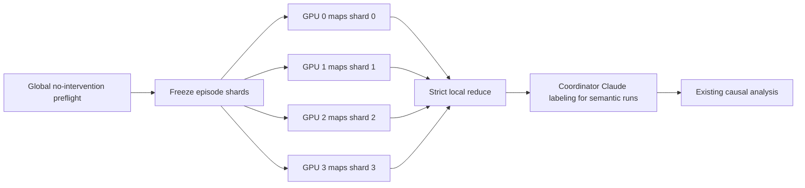

# Distributed causal replay

This workflow keeps causal replay scientifically identical while distributing
complete episodes across independent GPU workers. It is a local
**preflight → prepare → map → reduce** pipeline. S3 transports immutable files;
workers never communicate directly and never write the same object.



Every condition for one episode stays on one worker. Workers call the existing
condition builder and generation loop. Legacy rule-based runs analyse on reduction;
Claude runs merge generations, then label and analyse on the coordinator.
Distribution changes placement only, not the intervention or estimand.

## Mixed-data controls after #207

Two presets keep scientific inputs in YAML:

- `configs/causal_topk_mixed_layer25.yaml`: the focused TopK full-set / feature
  1666 / other-nine experiment, with contribution-matched controls. It uses
  natural ablation and 1%/2% edits, 100 feature draws and 3 random directions.
  The initial five-episode timing pilot has 916 generations per episode.
  Reducing to 20 feature draws gives 196 generations per episode and should be
  declared exploratory/dose-finding, not silently substituted in a frozen run.
- `configs/causal_mixed_layer25.yaml`: the broader raw-neuron, L1, TopK,
  pretrained and decoder-adapted comparison, with the exported raw probe
  direction and shared random directions. This exploratory preset limits
  evaluation to 20 episodes, five feature draws and three random directions.

Build missing labels and references with the same config, without loading the
Solver, invoking Claude, or adding scientific CLI arguments:

```bash
PYTHONPATH=src python scripts/causal_replay.py \
  --config configs/causal_topk_mixed_layer25.yaml --prepare-inputs
```

`input_preparation.collection_results` selects the frozen partitioned collection.
With `label_policy: claude`, preparation packages the completed
`claude.source_run` through `export_final_labels_for_probes.py`; missing or
incompatible Claude output stops preparation. It never substitutes rule-based
labels. `labels_csv` points to the semantic package. The existing feature-reference builder
uses `input_preparation.feature_selection_config` and `feature_selection_summary`;
it writes `feature_reference_activations.json` beside that summary. Existing
outputs are validated rather than overwritten. References must be recomputed
for the exact summary and decoders; the October references are incompatible.

Both presets use Claude semantic labels for eligibility and generated-answer
scoring. The stored run contains 1,814 adoption and 1,704 retention episodes:
3,518 eligible episodes before the configured pilot limit. Its three technical
failures are excluded only because `claude.source_errors: exclude` is explicit;
their IDs and reasons remain in the labeling audit. Agreement and out do not
enter the starting binary cohort. The obsolete
`mixed_final_001_intervention_candidate` rule-based package is not used.

GPU workers never create a Claude client. An exact stored-answer match reuses
that episode's frozen Claude judgment. Changed answers are saved as
`pending_claude` with a null adoption value. The preflight threshold counts
only known label matches; pending answers count as mismatches, so before API
labeling this is a conservative exact-text parity gate (98% by default).
Prompt/token checks and worker/coordinator answer parity remain in force.
Passing preflight does not make pending judgments available for analysis.

After serial generation or distributed reduction, the coordinator runs:

```bash
# Preview unique changed inputs, successful cache entries and pending requests; no API calls or writes.
PYTHONPATH=src python scripts/causal_replay.py --label-only "$MERGED_RUN" --dry-run
# Make Claude calls, publish judgments, and run analysis. Repeat this command to resume/retry.
PYTHONPATH=src python scripts/causal_replay.py --label-only "$MERGED_RUN"
```

The frozen YAML supplies concurrency, region and optional AWS profile under
`claude`. The source run supplies the exact model ID, prompt text hash/version,
sampling settings, token limit and retry count. Workers need the source
artifacts for hash verification but do not need AWS/Claude credentials.
The coordinator needs Bedrock access; preparation, preflight, map and reduce
make no Claude API calls.

Identical semantic inputs across conditions share one Claude request, but
output rows retain `(question_id, experiment, condition, draw)` identity.
Successful requests are reused after interruption; failures are retried on the
next labeling invocation. `claude_labeling/attempts/` preserves request/response
audits. Immutable raw generations stay in `per_row.jsonl`; completed judgments
are published atomically in `claude_labeled/`, with checksums tying them to
their inputs, protocol and audits. Analysis refuses pending or stale judgments.

By default `claude.generated_errors: stop` prevents analysis when API or
technical failures remain. The explicit alternative `exclude_episode` excludes
the entire affected question across every condition, records the exclusions,
and reports the reduced paired sample size. Failures are never retention.
Generated agreement/out labels remain separate in semantic diagnostics and
response counts; decreased adoption is not automatically increased retention.

The presets use `norm_edit_policy: cap_at_ablation` to prevent suppression
from passing zero. A requested 1% or 2% dose is not assumed feasible for every
target, subset and random draw. Capped edits can be smaller than requested;
tables label them with `≤`, and diagnostics report achieved norms, requested
and applied scales, would-overshoot, capping, applied overshoot and no-ops.
Random directions remain exact-size controls. Such comparisons are not
exactly norm-matched where the feature edits were capped. Ordinary ablation
and partial ablation (`scale_fractions` between -1 and 0) remain available.
Use `norm_edit_policy: allow` only in a separately declared extrapolating
direction-edit run. Do not copy the October `[-1.0, ..., 1.0]` dose grid: those
values are fractions, so -1 means 100% of the activation norm.

The broader preset's `probe_direction` is the raw-unit `w` artifact exported
by its feature-selection summary. Replay verifies hash, layer and width before
loading the Solver. Negative doses move against `w`, toward probe-predicted
retention. This artifact differs from the unweighted readout used in the earlier
offline matched-edit table; it is explicitly named to avoid substituting one
probe for another. The learned-direction analysis reuses the shared random
direction generations instead of generating duplicate controls.

Run a fresh preflight using the selected YAML, then follow prepare/map/reduce
below. Workers need the same code, raw-neuron center `.npy`, direction `.npz`,
original/adapted checkpoint files, labels, completed Claude source run, references and contexts at the
configured paths. The manifest freezes the resolved config/conditions and
checks input and checkpoint hashes. No new worker scientific flags are needed.
Do not change doses, policies, cohorts or draws inside an existing manifest.

The adapted checkpoint is staged under
`s3://dats-capstone/shared/group3/results/sae/decoder_finetuning/20261102T205853702830Z/best/`.
Preparing local inputs does not launch EC2/GPU jobs. Machine assignment, SSO/VPN
access and full-run approval remain operational steps after the timing pilot.
If pilot outcomes are used to select doses, subsequent results on that same
cohort remain exploratory.

## Requirements

All machines need:

- The same committed code and Python package versions.
- The causal config's referenced interactions, labels, contexts, feature
  summary/reference, and SAE files at the same repository-relative paths.
- The pinned Solver model available through the normal model cache.
- The same GPU model for the first production version. Device assignment can
  differ by setting `CUDA_VISIBLE_DEVICES`; the config may continue to use
  `cuda:0` inside each isolated worker process.

The preflight provenance enforces these requirements. A worker with different
code, inputs, packages, model settings, GPU model, SAE files, feature sets, or
hook site is rejected before intervention generation. Each worker also replays
the no-intervention baseline for its own episodes and must match the coordinator
on prompt hash, behavior label, and first generated token. This catches numerical
or environment differences that metadata alone cannot guarantee.

Set up the normal project environment on every machine:

```bash
export PYTHONPATH=src
```

Run every command from the repository root so the config's relative research
input and checkpoint paths resolve identically.

## 1. Run the global preflight once

On the coordinator, use the existing replay entry point:

```bash
python scripts/causal_replay.py \
  --config configs/causal_edit_size_layer33.yaml \
  --preflight-only
```

The printed run directory is `PREFLIGHT_RUN` below. It contains one no-SAE
baseline row per eligible episode and a successful `replay_check.json`.
Preparation refuses a failed, incomplete, or modified preflight.

## 2. Freeze the map shards

```bash
python scripts/distributed_causal_replay.py prepare \
  --preflight-run "$PREFLIGHT_RUN" \
  --num-shards 4
```

This writes `$PREFLIGHT_RUN/distributed/manifest.json`. The manifest freezes the
ordered episode list, balanced shard membership, preflight file hashes,
condition and feature hashes, and scientific identity. Changing the number of
shards requires a new distributed directory; it does not change episode order,
conditions, or random controls.

## 3. Upload the immutable input bundle

Use the same AWS CLI transport convention as distributed collection. Choose a
new S3 prefix for this run:

```bash
aws s3 sync "$PREFLIGHT_RUN/" "$S3_RUN_URI/" \
  --exclude "distributed/shards/*" \
  --exclude "distributed/merged/*"
```

This bundle is small compared with model and SAE checkpoints. The referenced
research inputs and checkpoints must already be staged at their config paths on
each worker; the manifest validates their hashes locally.

## 4. Map one shard per worker

Each worker downloads the same immutable bundle:

```bash
aws s3 sync "$S3_RUN_URI/" "$LOCAL_RUN/" \
  --exclude "distributed/shards/*" \
  --exclude "distributed/merged/*"
```

Worker 0 runs:

```bash
CUDA_VISIBLE_DEVICES=0 python scripts/distributed_causal_replay.py map \
  --manifest "$LOCAL_RUN/distributed/manifest.json" \
  --shard 0 \
  --resume
```

Workers 1–3 use shard IDs 1–3. On separate single-GPU instances each process can
also use `CUDA_VISIBLE_DEVICES=0`; shard ID, not CUDA ordinal, identifies work.

`--resume` repairs only an unfinished final JSONL record, verifies all committed
rows, and generates missing row keys. It skips a matching completed shard. A
worker loads the model once and processes only its assigned episodes. It first
regenerates those episodes' baselines and checks them against the successful
global preflight, then generates the intervention conditions. The extra baseline
is one generation per episode, versus hundreds of intervention generations.

Upload the shard payload first and `complete.json` last. The completion marker
is the commit point and contains checksums of the uploaded worker files:

```bash
SHARD=000000
aws s3 sync "$LOCAL_RUN/distributed/shards/$SHARD/" \
  "$S3_RUN_URI/distributed/shards/$SHARD/" \
  --exclude complete.json
aws s3 cp "$LOCAL_RUN/distributed/shards/$SHARD/complete.json" \
  "$S3_RUN_URI/distributed/shards/$SHARD/complete.json"
```

Do not run competing workers for the same shard. If a worker is replaced, stop
the old worker, download that shard's existing files, and rerun the same map
command with `--resume`.

## 5. Download and reduce

After every expected shard has a `complete.json`, the coordinator downloads all
map outputs beside the original manifest:

```bash
aws s3 sync "$S3_RUN_URI/distributed/shards/" \
  "$PREFLIGHT_RUN/distributed/shards/"
```

Then reduce locally:

```bash
python scripts/distributed_causal_replay.py reduce \
  --manifest "$PREFLIGHT_RUN/distributed/manifest.json"
```

Reduction requires exactly the prepared shard directories and validates:

- Completion-marker identities and file checksums.
- Worker scientific provenance.
- Worker baseline parity with the successful global preflight.
- A successful global replay check recomputed from the workers' baseline rows.
- Correct question ownership for every shard.
- Exact `(question_id, experiment, condition, draw)` coverage.
- No missing, duplicate, foreign, or unexpected rows.

It combines each worker's locally paired baseline and intervention rows in the
frozen episode/condition order and atomically
publishes `$PREFLIGHT_RUN/distributed/merged`. A failed validation or analysis
does not expose a partial merged directory.

Legacy rule-based runs analyse during reduction. Claude runs stop after the
generation merge; use `--label-only` on that merged directory for coordinator
labeling and analysis, as described above.

The merged run keeps the coordinator check as `preflight_replay_check.json` and
writes the workers' combined check as `replay_check.json`, so the final canonical
artifact describes the baselines actually used in its paired effects.

## Lightweight worker checklist

A worker needs only four actions:

1. Stage the repository, environment, model, research inputs, and SAE files.
2. Download the immutable preflight/manifest bundle.
3. Run one `map --shard N --resume` command.
4. Upload its shard, with `complete.json` last.

There is no worker registry, shared lock, message queue, direct networking, or
Python S3 client. AWS CLI handles transport; local Python handles computation and
validation.
