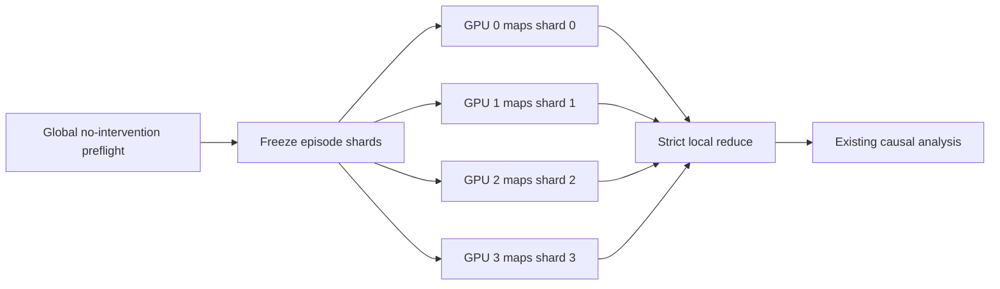

# Distributed causal replay

This workflow keeps causal replay scientifically identical while distributing
complete episodes across independent GPU workers. It is a local
**preflight → prepare → map → reduce** pipeline. S3 transports immutable files;
workers never communicate directly and never write the same object.



Every condition for one episode stays on one worker. Workers call the existing
condition builder and generation loop. The reducer calls the existing analysis.
Distribution changes placement only, not the intervention or estimand.

## Requirements

All machines need:

- The same committed code and Python package versions.
- The causal config's referenced interactions, labels, contexts, feature
  summary/reference, and SAE files at the same repository-relative paths.
- The pinned Solver model available through the normal model cache.
- The same GPU model for the first production version. Device assignment can
  differ by setting `CUDA_VISIBLE_DEVICES`; the config may continue to use
  `cuda:0` inside each isolated worker process.

The preflight provenance enforces these requirements. A worker with different
code, inputs, packages, model settings, GPU model, SAE files, feature sets, or
hook site is rejected before intervention generation. Each worker also replays
the no-intervention baseline for its own episodes and must match the coordinator
on prompt hash, behavior label, and first generated token. This catches numerical
or environment differences that metadata alone cannot guarantee.

Set up the normal project environment on every machine:

```bash
export PYTHONPATH=src
```

Run every command from the repository root so the config's relative research
input and checkpoint paths resolve identically.

## 1. Run the global preflight once

On the coordinator, use the existing replay entry point:

```bash
python scripts/causal_replay.py \
  --config configs/causal_edit_size_layer33.yaml \
  --preflight-only
```

The printed run directory is `PREFLIGHT_RUN` below. It contains one no-SAE
baseline row per eligible episode and a successful `replay_check.json`.
Preparation refuses a failed, incomplete, or modified preflight.

## 2. Freeze the map shards

```bash
python scripts/distributed_causal_replay.py prepare \
  --preflight-run "$PREFLIGHT_RUN" \
  --num-shards 4
```

This writes `$PREFLIGHT_RUN/distributed/manifest.json`. The manifest freezes the
ordered episode list, balanced shard membership, preflight file hashes,
condition and feature hashes, and scientific identity. Changing the number of
shards requires a new distributed directory; it does not change episode order,
conditions, or random controls.

## 3. Upload the immutable input bundle

Use the same AWS CLI transport convention as distributed collection. Choose a
new S3 prefix for this run:

```bash
aws s3 sync "$PREFLIGHT_RUN/" "$S3_RUN_URI/" \
  --exclude "distributed/shards/*" \
  --exclude "distributed/merged/*"
```

This bundle is small compared with model and SAE checkpoints. The referenced
research inputs and checkpoints must already be staged at their config paths on
each worker; the manifest validates their hashes locally.

## 4. Map one shard per worker

Each worker downloads the same immutable bundle:

```bash
aws s3 sync "$S3_RUN_URI/" "$LOCAL_RUN/" \
  --exclude "distributed/shards/*" \
  --exclude "distributed/merged/*"
```

Worker 0 runs:

```bash
CUDA_VISIBLE_DEVICES=0 python scripts/distributed_causal_replay.py map \
  --manifest "$LOCAL_RUN/distributed/manifest.json" \
  --shard 0 \
  --resume
```

Workers 1–3 use shard IDs 1–3. On separate single-GPU instances each process can
also use `CUDA_VISIBLE_DEVICES=0`; shard ID, not CUDA ordinal, identifies work.

`--resume` repairs only an unfinished final JSONL record, verifies all committed
rows, and generates missing row keys. It skips a matching completed shard. A
worker loads the model once and processes only its assigned episodes. It first
regenerates those episodes' baselines and checks them against the successful
global preflight, then generates the intervention conditions. The extra baseline
is one generation per episode, versus hundreds of intervention generations.

Upload the shard payload first and `complete.json` last. The completion marker
is the commit point and contains checksums of the uploaded worker files:

```bash
SHARD=000000
aws s3 sync "$LOCAL_RUN/distributed/shards/$SHARD/" \
  "$S3_RUN_URI/distributed/shards/$SHARD/" \
  --exclude complete.json
aws s3 cp "$LOCAL_RUN/distributed/shards/$SHARD/complete.json" \
  "$S3_RUN_URI/distributed/shards/$SHARD/complete.json"
```

Do not run competing workers for the same shard. If a worker is replaced, stop
the old worker, download that shard's existing files, and rerun the same map
command with `--resume`.

## 5. Download and reduce

After every expected shard has a `complete.json`, the coordinator downloads all
map outputs beside the original manifest:

```bash
aws s3 sync "$S3_RUN_URI/distributed/shards/" \
  "$PREFLIGHT_RUN/distributed/shards/"
```

Then reduce locally:

```bash
python scripts/distributed_causal_replay.py reduce \
  --manifest "$PREFLIGHT_RUN/distributed/manifest.json"
```

Reduction requires exactly the prepared shard directories and validates:

- Completion-marker identities and file checksums.
- Worker scientific provenance.
- Worker baseline parity with the successful global preflight.
- A successful global replay check recomputed from the workers' baseline rows.
- Correct question ownership for every shard.
- Exact `(question_id, experiment, condition, draw)` coverage.
- No missing, duplicate, foreign, or unexpected rows.

It combines each worker's locally paired baseline and intervention rows in the
frozen episode/condition order, runs the existing causal analysis, and atomically
publishes `$PREFLIGHT_RUN/distributed/merged`. A failed validation or analysis
does not expose a partial merged directory.

The merged run keeps the coordinator check as `preflight_replay_check.json` and
writes the workers' combined check as `replay_check.json`, so the final canonical
artifact describes the baselines actually used in its paired effects.

## Lightweight worker checklist

A worker needs only four actions:

1. Stage the repository, environment, model, research inputs, and SAE files.
2. Download the immutable preflight/manifest bundle.
3. Run one `map --shard N --resume` command.
4. Upload its shard, with `complete.json` last.

There is no worker registry, shared lock, message queue, direct networking, or
Python S3 client. AWS CLI handles transport; local Python handles computation and
validation.
