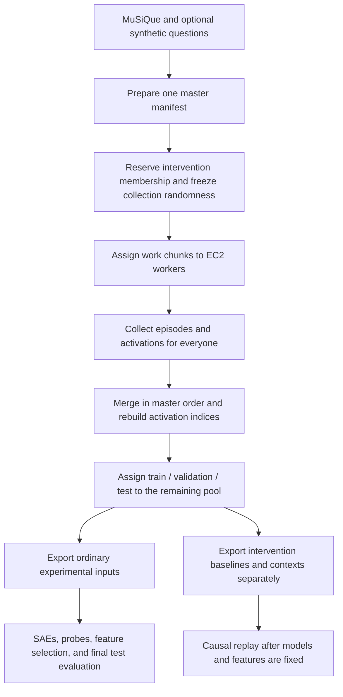

# Distributed episode and activation collection

The workflow is **prepare → collect → merge → split**. Work chunks distribute
compute; research partitions control permitted use. Intervention membership is
frozen before collection, and its baseline episodes/activations are collected
alongside everyone else's. Ordinary train/validation/test membership is assigned
after merging. Intervention results are exported under a separate run name.

Use [the two-EC2 smoke run](distributed_collection_smoke_test.md) before scaling.



## Prepare once, without loading models

Start from [the example YAML](../configs/collection/distributed.yaml). It reuses
the existing role/model, protocol, and activation settings. Review the run name,
intervention reservation, and split proportions for your experiment. Fractions
in the example are starting values, not a new agreed research protocol.

```bash
export PYTHONPATH=src
python scripts/distributed_collection.py prepare \
  --config configs/collection/distributed.yaml --num-chunks 8 \
  --output artifacts/collection/mixed_collection/manifest.json
```

Each input names `source`, `version`, and a JSON/JSONL `path`; optional
`source_split`, `id_field`, `hop_field`, and `group_field` describe its records.
MuSiQue input IDs can supply hop metadata. Synthetic inputs require an explicit
hop field or input-level `hop`. Every record needs `id`, `question`, `paragraphs`,
and `answer`; aliases are retained. Source names may not contain a colon.

For example, append a real synthetic release to `dataset.inputs`:

```yaml
- source: synthetic
  version: RELEASE_ID
  path: data/synthetic/questions.jsonl
  hop_field: hop_group
  # group_field: parent_question_id
```

Synthetic data is optional. No real synthetic release has been validated in this
repository; fixtures establish the adapter behavior, not producer data quality.
Paragraph records must have the same structure used by the existing collector.

Global IDs are `source:original_id`; original IDs/splits, payloads, source hashes,
known exposure flags, and generation provenance are retained. If variants are
related, supply the same **globally qualified** `split_group_id` (or `group_field`
value) for every family member, including its original question. Families stay
together in intervention reservation and later splitting. Family proportions
are approximate at question level; final counts report actual membership.
There is no automatic semantic deduplication.

`dataset.intervention` takes either `fraction` plus an optional `seed`, or
`question_ids_file` containing unique namespaced IDs. An explicit list expands
to the selected questions' complete families. Prepared membership never changes
when work is retried. Per-question seeds and candidate orders are frozen before
chunking and are independent of chunk count or worker assignment.

Preparation also freezes `dataset.split` proportions and the effective split seed
(defaulting to the collection seed). Collection and export reject changes to these
settings; partition membership is still assigned during export. Manifests created
before split settings were frozen must be prepared again.

## Collect on each EC2 worker

Copy the same manifest and collection YAML to each worker. Original dataset
files are unnecessary: the manifest contains the exact question payloads.
Assign non-overlapping work chunk IDs manually.

```bash
python scripts/collect_activations.py \
  --config configs/collection/distributed.yaml \
  --manifest artifacts/collection/mixed_collection/manifest.json \
  --chunk 0 1 2 3
```

The other worker can take `--chunk 4 5 6 7`. Omit `--chunk` to process every
prepared chunk on one machine. Models load once per invocation. Add `--resume`
to finish an interrupted assignment or skip matching completed chunks.

`--num-chunks` sets distribution. `output.chunk_size` controls how many questions
are committed per checkpoint inside a work chunk. A killed process repeats only
the unfinished checkpoint batch. Unexpected model/infrastructure errors stop
collection; the collector's existing scientific exclusions retain their reasons.
The initial manifest path, not `output.run_name` alone, determines the local
output root. Keep the run directory on durable storage when replacing instances.

The new production path requires one critic condition and one A2 presentation
per question, matching existing production manifest semantics. Legacy sampling
and the general multi-episode collector remain available without `--manifest`.

## Transfer and merge

Use AWS CLI with your normal AWS profile; no Python transport or S3 acceptance
registry is involved. Each chunk directory has checkpoint files, provenance, and
`complete.json`. Upload completion last, for example:

```bash
aws s3 sync artifacts/collection/mixed_collection/chunks/000000/ \
  s3://YOUR_BUCKET/YOUR_PREFIX/mixed_collection/chunks/000000/ --exclude complete.json
aws s3 cp artifacts/collection/mixed_collection/chunks/000000/complete.json \
  s3://YOUR_BUCKET/YOUR_PREFIX/mixed_collection/chunks/000000/complete.json
```

Upload only your assigned chunks. Stop an old worker before reassigning its
chunk. Conflicting competing attempts are unsupported; merge rejects duplicate
or foreign chunk directories instead of choosing a result.

Download all completed chunks beside the manifest, preserving directory names:

```bash
python scripts/distributed_collection.py merge \
  --manifest artifacts/collection/mixed_collection/manifest.json
```

Merge checks completion hashes, membership, coverage, seeds, candidate orders,
record/tensor alignment, and scientific settings. Hardware and package metadata
are recorded rather than used as compatibility gates. Different GPU numerics
can still produce different generations. Missing resolved model revisions are
recorded as unknown; requested revisions remain in provenance.
For cross-worker comparison only, a missing resolved revision can match an
identical full 40-character requested commit pin. Any recorded resolution must
agree with that pin. Branches, tags, and unpinned revisions retain strict
comparison. Original worker provenance and completion hashes remain unchanged.

Records are merged in master order. A1 and A2 stay separate until producing
`cat(all_A1, all_A2)`. One captured layer is materialized at a time; memory still
needs roughly one layer's merged A1+A2 plus a loaded checkpoint and concatenation
copies. Disk must hold checkpoints, raw merged tensors, and partitioned exports.

`merged/` contains internal `activations/raw/layer_NN/all*.pt`,
`results/raw/all/interactions.jsonl`, coverage, and worker provenance. It is not
an SAE training run. Checksums detect changes between merge and split.

## Freeze later partitions and export

```bash
python scripts/distributed_collection.py split \
  --manifest artifacts/collection/mixed_collection/manifest.json \
  --config configs/collection/distributed.yaml
```

Splitting uses all non-intervention master questions, including collection
exclusions. It stratifies by source/hop and candidate order while respecting
explicit families. It does not use outcomes, labels, or activation values.
Freeze before training/tuning or using held-out results to make decisions.
An existing output is never overwritten; re-collection must retain the exported
membership rather than redefining an evaluation after development has begun.

The atomically published `prepared/` bundle holds:

```text
partitions.csv                          # all master questions, including exclusions
split.json                              # manifest identity and split settings
activations/mixed_collection/layer_NN/{train,validation,test}*.pt
results/mixed_collection/{train,validation,test}/interactions.jsonl
results/mixed_collection/{partitions.csv,split_manifest.csv,counts.json,run_layout.json,collection_status.json}
activations/mixed_collection_intervention/layer_NN/intervention*.pt
results/mixed_collection_intervention/intervention/interactions.jsonl
results/mixed_collection_intervention/contexts.jsonl
```

Each run's membership file covers its own permitted questions, including its
exclusions; the bundle-level `partitions.csv` is the complete master mapping.
Empty splits have empty interaction files and explicit status, without fabricated
activation rows. They cannot be used as usable train/evaluation data.

Final `source_split` is the actual folder; `original_source_split` retains origin.
`full_index` and attempt indices address the **final split's** tensors. Combined
SAE indices address A1 followed by A2. `collection_activation_index` records the
original raw row. New outputs deliberately omit the legacy
`source_activation_index` override; historical exports retain their old semantics.

Both merge and export build under one temporary parent, then rename the complete
bundle. A failed build exposes no final destination; retry from preserved chunks.
Killed-process staging directories can be removed after confirming the process
has stopped. No reader hooks or multi-tree publication recovery are required.

## Labels and downstream experiments

Generate labels against each final run, retaining existing label rules:

```bash
python scripts/prepare_behavior_v01.py \
  --full-results artifacts/collection/mixed_collection/prepared/results/mixed_collection \
  --layout partitioned --label-policy v0.2.0-candidate \
  --output artifacts/collection/mixed_collection/labels

python scripts/prepare_behavior_v01.py \
  --full-results artifacts/collection/mixed_collection/prepared/results/mixed_collection_intervention \
  --layout partitioned --label-policy v0.2.0-candidate \
  --output artifacts/collection/mixed_collection/intervention-labels
```

Use the matching feedback label policy for a feedback collection. Historical
labels must not be attached to newly generated answers. Source hashes are taken
from final interaction files. Labels are post-processing, not worker-side judging.

Point SAE loaders at `prepared/activations/mixed_collection/layer_NN`. For probes,
point `results_dir` and `activations_dir` at that same ordinary run and
`labels_csv`/`manifest_csv` at its new behavior package. Use `index_column:
full_index`, `source_splits: [train, validation]`, and, for candidate behavioral
selection, `target_column: strict_target`, `eligible_column: eligible_strict`.
Feature-selection configs accept those target/eligibility settings as well.
Existing test/intervention authorization remains in effect.

For causal replay, retain the chosen SAE and feature-selection settings, then
point its data inputs at the separate intervention run/package:

```yaml
interactions_jsonl: artifacts/collection/mixed_collection/prepared/results/mixed_collection_intervention/intervention/interactions.jsonl
contexts_jsonl: artifacts/collection/mixed_collection/prepared/results/mixed_collection_intervention/contexts.jsonl
labels_csv: artifacts/collection/mixed_collection/intervention-labels/labels.csv
partition: intervention
label_policy: v0.2.0-candidate
```

Replay uses the saved context and candidate order, calls `Solver.choose` for
candidates, and uses the matching existing label policy. Candidate baseline
cohorts use `eligible_strict`/`strict_target`; post-intervention third answers
remain reported outcomes. Legacy feedback configs retain their original label
policy, prompt, and MuSiQue lookup. The unchanged no-intervention replay check
must pass before feature interventions execute.
