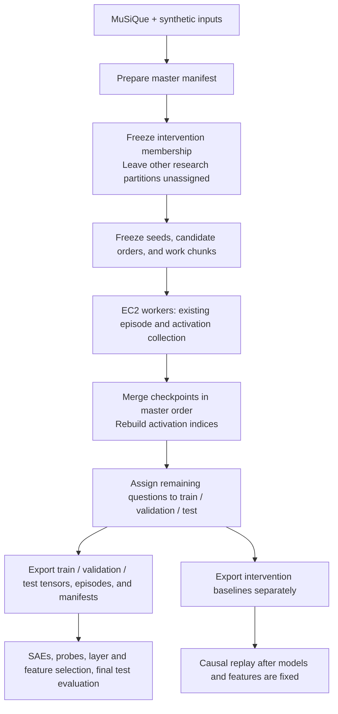

# Plan: simplify distributed activation collection

Status: implemented and validated locally. Live EC2/S3 smoke validation remains
an operational follow-up before scaling. The original plan and review rationale
are retained below.

Reviewed against `issue160-partition-collection-runs` at `95e5b23`, with
`6b8dc29` as the branch base. The branch currently changes 30 files, adding
about 3,640 lines. The goal is to replace its distributed workflow with the
smallest implementation that preserves experimental correctness.

## 1. Intended behavior

Prepare one mixed question dataset, reserve intervention membership, and divide
the dataset into work chunks. EC2 workers run the existing episode and
activation collector on assigned chunks. After collection, merge the results,
assign the remaining questions to train/validation/test, and produce the normal
experimental inputs.

**Reserving intervention controls permitted use; it does not prohibit baseline
inference.** The proposed default is to collect intervention baseline episodes
in the initial distributed run, then export them separately. They never enter
SAE training, probe training, tuning, or feature selection.



Original MuSiQue train/validation membership remains source metadata. It does
not determine the new mixed dataset's research assignments. Already recorded
development exposure remains metadata; inference itself does not mark a
question as used for development.

## 2. Keep the command surface small

The following is a proposed interface, not commands implemented by this plan:

```bash
# Once, on a CPU machine: combine inputs, reserve intervention, assign work.
PYTHONPATH=src python scripts/distributed_collection.py prepare \
  --config configs/collection/distributed.yaml \
  --num-chunks 8 \
  --output artifacts/collection/RUN/manifest.json

# EC2 A; EC2 B runs the same command with its own non-overlapping chunk IDs.
PYTHONPATH=src python scripts/collect_activations.py \
  --config configs/collection/distributed.yaml \
  --manifest artifacts/collection/RUN/manifest.json \
  --chunk 0 1 2 3

# A single worker may omit --chunk to process every planned chunk.
# Add --resume to continue already checkpointed assigned work.

# Once, after downloading all completed chunks.
PYTHONPATH=src python scripts/distributed_collection.py merge \
  --manifest artifacts/collection/RUN/manifest.json

# Once, before fitting/tuning: freeze research membership and export inputs.
PYTHONPATH=src python scripts/distributed_collection.py split \
  --manifest artifacts/collection/RUN/manifest.json \
  --config configs/collection/distributed.yaml
```

`--chunk` accepts one or more IDs. A worker loads models once for its assignment.
Omitting it processes the same planned chunks through the same implementation,
rather than switching to a second collection algorithm.

One YAML holds source specifications, existing role/model and collection
settings, intervention reservation settings, eventual split proportions, and
output naming. Reuse the current collection config parser and add a narrowly
scoped manifest-input alternative to its MuSiQue sampling fields. Do not make
users fill in dummy `source_split` or `num_questions` values. Manifest collection
and legacy sampling must be unambiguous alternatives.

Work chunk count determines distribution across machines. Existing
`output.chunk_size` remains the checkpoint batch size within a worker's work
chunk. These serve different purposes and must have distinct help text.

### Transfer between EC2 instances

Use ordinary `aws s3 cp` / `aws s3 sync` commands in the runbook. Publish the
same prepared manifest and agreed YAML once; each worker uploads only its
assigned chunk directory. Upload the chunk's completion metadata last. Download
completed directories to the same relative layout before merging.

The code operates on local files and does not manage EC2, AWS credentials,
worker scheduling, or S3 acceptance decisions. Copies downloaded before upload
completion cannot merge successfully. Completion metadata contains file sizes
and hashes; merge verifies them rather than trusting an S3 listing or ETag.

Assign one owner per logical chunk. For a replacement worker, stop the old owner
before transferring ownership. Conflicting duplicate results must fail, not be
silently selected. Concurrent competing attempts and automatic winner selection
are outside this workflow.

## 3. Reuse and removal decisions

Apply recycle-code by preserving compatible responsibilities, rather than
keeping whole modules because they already exist.

| Existing code | Decision and reason |
| --- | --- |
| `collection.collect_examples` and the Solver/Critic/Validator pipeline | Reuse. They already run episodes and capture the required activations. |
| Branch addition `question_seeds` in `collect_examples` | Keep. It makes generation independent of worker/chunk boundaries. |
| `collection_progress.write_chunk`, prefix/resume checks, `merge_chunks` | Reuse. They already keep A1/A2 separate, track exclusions, and rebuild indices. Add only the explicit checkpoint-path support needed for several workers. |
| `save_collection_artifacts`, `_add_sae_indices`, `_save_and_verify`, `ActivationStore` | Reuse for tensor construction, alignment, and round-trip checks. Keep the store local. |
| `production.export_partition_activations` and production activation loading | Reuse the gathering, authorization, and A1/A2 export logic. Add a small new-output normalization step for final local indices and storage names. |
| `assign_experiment_splits`, `allocate_counts`, proportion validation | Reuse for reservation, split allocation, and candidate balancing where the semantics match. |
| Branch support for explicit hop groups in split/candidate helpers | Keep. Namespaced/synthetic IDs must not be parsed as MuSiQue IDs. |
| `build_master_dataset` | Keep and simplify. It already preserves payloads, sources, and namespaced IDs. |
| `partition_adapter.py` | Reduce to origin metadata, manifest construction, exposure parsing, and coverage code actually used by final outputs. Remove upfront-partition assumptions and historical assignment migration. |
| Partitioned-layout reading in production/scripts | Keep only the pieces used to read the final exports, including a separate intervention run. Preserve the pre-branch legacy path. |
| `build_resolved_config` and existing provenance helpers | Reuse for actual worker settings and audit metadata. Retain a small experiment-settings comparison. |
| `freeze_partitions`, `_weighted_assignment`, partition-specific `plan_chunks` | Replace with intervention reservation plus simple deterministic work chunk assignment. Four-way splitting happens later. Remove duplicate proportion/rounding logic. |
| `write_work_packages`, `validate_work_package` | Remove. One shared manifest contains payloads and assignments; workers select their own slices. No full plan embedded repeatedly in per-chunk packages. |
| `S3Transport`, reachability probing, upload/download/accept commands, attempt registries, receipts | Remove. AWS CLI transfer plus completed-file checks covers this workflow. |
| `--prepare-compatibility` and mandatory pre-generated compatibility schema | Remove. CPU preparation should not load the models. Compare scientific settings recorded by the workers themselves. |
| Multi-tree publication/recovery machinery in `publication.py` and finalization | Replace with a single staged output directory renamed after successful construction. Remove branch reader hooks for the old publication protocol once no callers remain. |
| Branch-only tests/docs/config examples | Retain and adapt useful scientific/alignment tests. Remove coverage and instructions for deleted commands and protocols. |

Small branch improvements to shared utilities, such as no-overwrite atomic JSON
creation, stay only if the new path uses them. Revert unused branch-only changes
to shared files instead of keeping speculative helpers. Do not reset whole
shared files or disturb pre-branch behavior.

## 4. Preparation and stable identity

Preparation writes one self-contained `manifest.json` with:

- Run identity, ordered questions, input content hashes, and chunk membership.
- Stable `question_id = dataset_source:original_id` and the original ID, source
  dataset/split/version, explicit hop metadata, and untouched collection payload.
- Frozen intervention membership, collection seed, and candidate order when used.
- Explicit supplied question-family metadata and known development exposure.

Keep master position, research membership, collection status, and activation
row index distinct. A master position is never assumed to be a tensor index.

Intervention can be reserved by an explicit ID list or a configured seeded
fraction. Fractions and seeds are experiment configuration; do not silently
reuse the historical MuSiQue split policy. Preserve existing reserved IDs when
an explicit list is supplied. Importing an intervention list or exposure flags
does not require importing historical train/validation/test assignments.

If synthetic inputs identify variants of an original question, reserve and
split that explicit question family together. Use the existing allocation
helpers around a small family grouping step; do not add semantic deduplication
or a general grouping framework. Family allocation can make question-level
proportions approximate; report actual counts. Without supplied relationships,
independence of synthetic examples remains a producer assumption to document.

Assign candidate orders once across source/hop/reservation groups before work
chunking. Use the existing balancing helper with explicit metadata. Generate
per-question seeds from the run seed and stable ID. Neither decision depends on
worker identity, chunk size, nor eventual train/validation/test assignments.

Store basic generation provenance supplied by the synthetic producer. Validate
the actual collection fields, duplicate IDs, and necessary metadata. The repo
currently contains only a proposed synthetic contract and handcrafted fixtures;
do not claim a real synthetic release is already integrated or validated.

## 5. Worker collection and interruption behavior

Replace the portable-work-package branch in `collect_activations.py` with
manifest selection, retaining its model-loading and agent setup.

1. Validate assigned chunk IDs and ordered question membership before model load.
2. Load configured models once and record their actual resolved configuration.
3. For each assigned work chunk, use the existing checkpoint loop and frozen
   question seeds/candidate orders.
4. Checkpoint only complete batches. A killed process resumes after the last
   committed batch; it may repeat the incomplete batch, not the whole work chunk.
5. Write completion metadata only when all intended questions have either
   records or an explicit collection exclusion.

Do not change question/episode IDs during retries or exports. Preserve original
payload IDs in metadata while supplying namespaced IDs to the collector. Build
sampled-question metadata from the manifest's explicit hop fields; the current
`describe_sampled_questions` parses IDs and is unsuitable unchanged.

Collection exclusions remain separate from behavioral eligibility. Never catch
an infrastructure/model failure and turn it into a successful completed chunk.

Retain only material experiment checks: models/revisions when reported,
generation settings, prompt contents, protocol, active conditions,
presentation, dtype/quantization, activation sites, and compatible tensor
dimensions. Reuse the existing recorded fields and prompt hashes; remove the
separate schema-validation/contract-preparation workflow. Compare worker facts
at merge, excluding paths, timestamps, GPU model, Git cleanliness, and package
versions. Record those operational facts for audit.

Missing resolved-revision metadata is not by itself a new prohibition on a
model loader that previously worked. Keep the requested revision and report
unknown resolution explicitly. Different machines can still have numerical
differences; deterministic assignments are not a promise of GPU bitwise equality.

## 6. Merge without introducing another index algorithm

The merger reads only complete logical chunks and validates:

- Manifest/run identity and exact expected chunk membership.
- Every master question accounted for once as collected or explicitly excluded.
- No duplicate question/episode IDs, unexplained gaps, overlapping ownership,
  foreign records, or changed completed files.
- Frozen seeds and candidate orders, compatible experiment settings, activation
  sites, dimensions, and A1/A2 record counts.

Use the existing `collection_progress` merge implementation. Its current entry
point assumes a single local progress directory. Add a small explicit-path
entry point sharing the same merge body, with checks that the ordered checkpoint
memberships cover the expected master sequence. Keep local resume prefix checks
unchanged. Do not copy all activation files into another progress directory just
to satisfy the current API.

Merge checkpoints in planned order, regardless of download order. A1 indices
advance by successful questions, A2 indices by episodes, and combined SAE tensors
remain `cat(all_A1, all_A2)`. Never concatenate already-combined per-chunk SAE
tensors: that would produce `A1,A2,A1,A2` and invalidate the offsets.

Write one internal raw collection under a neutral storage name such as `all`.
Do not call this research `train`. This internal format is consumed by split/
export, not by training scripts. Process one activation site at a time using
the branch's existing approach to avoid holding all layers' merged tensors.
Document remaining memory/disk needs rather than claiming unlimited streaming.

Build raw activations, interactions, coverage, and metadata under one temporary
root and rename that root only after validation. Final split/export uses the
same pattern. Existing writers already accept configurable roots. Downstream
configs can point inside the completed bundle; no duplicate permanent copies or
symlinks into the old global roots are required.

This removes the need for two-tree recovery identities and publication flags.
Existing final destinations are never overwritten. Interrupted staging is
discardable and can be rebuilt from the preserved completed chunks.

## 7. Split and export: the main bookkeeping boundary

After merge, assign train/validation/test to the entire non-intervention master
pool using sorted IDs, configured proportions/seed, and source/hop strata.
Use candidate order as an additional stratum when applicable so presentation
balance survives the later split. Respect supplied question families, with
reported approximate counts where necessary.

Allocate from master membership, not only successful or eligible episodes.
Thus collection failures do not redefine the question pool. Freeze membership
for excluded questions too; retries retain their assignments. Do not use
answers, correctness, labels, or activation values to choose memberships.
No later step reshuffles an existing frozen assignment.

The split seed/proportions may be configured ahead of collection, but the command
does not assign ordinary research membership until this step. Freezing occurs
before training, tuning, feature selection, or inspecting held-out outcomes to
make development decisions.

Reuse the export gathering logic to produce:

- An ordinary run with `train`, `validation`, and `test` interactions and tensors.
- A separately named intervention run with baseline episodes and, when present,
  its captured activation tensors. It is never placed next to ordinary SAE input
  splits under the same activation run.
- Frozen `partitions.csv`, actual-row `split_manifest.csv`, source metadata,
  exclusions/coverage, intervention IDs, and the layout descriptors actually
  needed by consumers.

The final manifest contract must be explicit:

| Field | Meaning in new final artifacts |
| --- | --- |
| `question_id` / `episode_id` | Stable semantic identity, unchanged by exports. |
| `original_source_split` | Original MuSiQue/source origin; never used as an activation address. |
| `source_split` | Actual final tensor and interaction folder, such as `validation`. |
| `partition` | Permitted research use. |
| `full_index` | Current row in that final split's A1/A2 tensors, for the supported production configuration. |
| `attempt1_activation_index`, `attempt2_activation_index` | Actual current tensor addresses rebuilt from exported order. |
| `sae_attempt1_index`, `sae_attempt2_index` | Addresses into the combined final split tensor. |
| `collection_activation_index` | Original merged address retained only for traceability. |

**Important existing behavior:** the current exporter writes
`source_activation_index`, and `probe.behavior_data` treats that field as the
index to verify against `full_index`. The new outputs will use local final
indices consistently and store raw provenance under
`collection_activation_index`, without the legacy override field. Do not combine
a new local manifest with an old-style original-index override. Keep old
artifacts and their current loading semantics intact.

For example, suppose raw successful question order is `qA, qB, qD`, with `qC`
excluded. If `qD` becomes the only validation question, its raw index is `2`,
but its final validation `full_index`, A1 index, and A2 index are all `0`.
Its combined SAE A2 index is `1`, and `collection_activation_index` is `2`.
`qC` retains research membership and an exclusion reason, with no tensor row.
This is the kind of case the integration fixtures must verify explicitly.

Normalize final storage names and indices before generating labels or source
hashes. Generate manifests from the actual exported records. Reuse the current
label classifiers and package writers; do not reuse a historical run's labels
for newly generated answers. Label generation remains a distinct experimental
operation, not worker-side LLM judging. Final source hashes must refer to the
final interaction files that consumers open.

Empty or entirely excluded partitions need explicit status. They must not be
silently dropped or made to look like usable training/evaluation data. A small
smoke run must have enough successful examples to exercise each required split.

## 8. Downstream integration work that cannot be skipped

### SAE, probes, and behavior packages

Keep existing tensor filenames and A1/A2 ordering. Keep current partition-use
checks. Adapt the branch's explicit-layout manifest readers to final ordinary
and separate intervention exports, without their current requirement that
intervention must be uncollected. Remove obsolete publication checks rather
than manufacturing old publication metadata.

Use current label policies. Candidate runs must use candidate-compatible labels
and configured target/eligibility columns; feedback runs retain their existing
policy. Update new example configs to point at matching tensors, interactions,
labels, and manifests. Historical scientific configs remain unchanged.

The simplified production path initially supports the current one-condition,
one-presentation-per-question configuration. Existing production manifests
already assume equal A1/A2 row counts. Fail clearly before expensive collection
if this new path receives an unsupported multi-episode configuration. Preserve
the existing general collector; do not invent a new episode-level manifest
framework as part of this work.

### Causal replay

The current replay implementation is not automatically compatible with the new
mixed collection:

- `load_paragraphs` fetches original MuSiQue IDs by `source_split`. Namespaced
  IDs, an `intervention` storage folder, and synthetic questions violate that
  assumption.
- `load_episodes` fixes the legacy v0.1.2 label policy, and `generate` always
  calls the feedback-style revision prompt. Current candidates collection needs
  the stored candidate presentation/order and its matching label policy.

Add a small source-context input using the prepared master manifest's exact
payloads. Export the reserved payloads with the separate intervention bundle,
so replay does not depend on an absolute preparation path or a live Hub fetch.
Preserve paragraphs and their order, question/answer aliases, presentation,
candidate order, and baseline prompt metadata. Retain the legacy MuSiQue lookup
for existing configs.

For the current candidates path, call the existing `Solver.choose` method and
existing candidate label policy; preserve `Solver.revise` for legacy feedback.
Carry the selected policy's target/eligibility semantics consistently through
baseline selection, regenerated labels, and replay checks. Do not silently
reinterpret third answers or change the causal outcome definition. Keep the
existing no-intervention replay preflight before feature interventions.

This is a bounded compatibility change, not a rewrite of causal analysis.
It belongs in the plan because accepting only the SAE/probe loaders would leave
the stated end-to-end integration incomplete.

## 9. Implementation sequence

1. **Capture the output contract and fixtures.** Reuse the existing identifiable
   tensor fixtures and downstream integration setup. Establish expected final
   row addresses, including intervention baselines and exclusions.
2. **Replace preparation.** Reuse master import and split/candidate helpers;
   write the shared manifest with intervention membership and ordinary questions
   still unassigned. Add the single new example YAML.
3. **Wire manifest workers.** Replace work packages with optional chunk selection;
   reuse agent loading, collection, and checkpoint/resume. Preserve legacy runs.
4. **Simplify merge.** Reuse the shared index merge body, explicit checkpoint paths,
   one-site-at-a-time persistence, checksums, and staged output root.
5. **Implement split/export.** Freeze later memberships, reuse tensor gathering,
   normalize local addresses, write manifests and separate intervention inputs,
   and generate labels/source hashes only against final records.
6. **Finish consumer integration.** Exercise real SAE/probe/label loaders; add the
   required context and presentation compatibility to causal replay.
7. **Remove superseded branch code.** Delete old commands, transports, packages,
   historical assignment import, strict preflight contracts, publication recovery,
   unused exports/imports, and tests/docs that only served those paths. Inspect
   every changed file against the branch base; every retained addition needs a
   live caller in this pipeline or an existing supported consumer.
8. **Document and validate.** Replace the existing long distributed guide/smoke
   instructions with the prepare → collect → merge → split workflow, exact path
   examples, per-worker AWS transfers, and downstream config examples.

Intermediate commits may temporarily retain old code to make changes reviewable;
the completed branch should contain one distributed workflow. Keep baseline
single-machine collection and historical artifact reading supported.

## 10. Validation and acceptance criteria

Use meaningful integration tests, adapting existing fixtures instead of testing
every new helper in isolation.

| Check | Required evidence |
| --- | --- |
| Serial versus distributed | Identical fixture records and tensors for all planned chunks on one worker versus assigned workers, including reversed arrival order. |
| Identity and randomness | Stable seeds, candidate orders, IDs, and reserved membership across different work chunk counts and assignments. |
| Exact row alignment | Unique tensor values encode question, attempt, and layer. Verify every manifest lookup and combined SAE offset, not only shapes. |
| Exclusions | Failures at beginning/middle/end, an entirely excluded checkpoint, and exclusions in the intervention pool; no activation addresses for absent rows. |
| Corruption and coverage | Missing/duplicate/foreign chunks, missing records, incompatible settings, changed completed files, wrong candidate orders, and bad indices fail clearly. |
| Resume | An interrupted worker preserves committed batches; resume produces the same final outputs and refuses a mismatched manifest/config. |
| Real downstream loading | Load final artifacts through `create_sae_dataloader`, production activation loading, probe episode alignment/selection, and the behavior-package entry point. Every vector remains attached to its expected question. |
| Original versus local indices | Deliberately arrange raw and exported indices to differ. The new manifests/loaders agree on local addresses; historical original-index behavior still passes. |
| Intervention isolation | Baselines exist separately; ordinary fit/tune/feature selection cannot include them, and their IDs never enter train/validation/test. |
| Causal replay | Actual episode/context loading resolves namespaced MuSiQue and synthetic fixtures without Hub access. Both supported presentations build the expected prompt and use matching labels; a failed baseline replay check blocks interventions. |
| Publication | Failure during merge/export exposes no final bundle; rerun from preserved chunks works without multi-tree recovery. |
| Legacy behavior | Relevant pre-branch collection/progress/production/probe/causal tests continue to pass. |

Run focused collection, progress, artifact, production-data, split integration,
probe-alignment, and causal-replay tests, plus existing config/provenance tests
affected by cleanup. Finish with `git diff --check`, CLI help, and an audit for
dead imports, obsolete commands, and unused branch additions.

After CPU fixture validation, perform the documented small two-EC2 smoke run
with real models and S3 before scaling. It should cover both ordinary and
intervention baselines, a resume, transfer, merge/export, and downstream input
loading. Keep the smoke run disposable. Report separately which checks ran with
mocks, which used real model inference, and which used actual AWS transfer.

The plan-writing step does not launch EC2, paid inference, or AWS transfers.
Those operational checks occur during implementation validation in the team's
chosen environment.

### Definition of done

- Each EC2 worker needs one collection command plus standard file transfer.
- No train/validation/test assignment is required before collection.
- Intervention membership is frozen before collection and stays isolated in use.
- Final exports work with real experimental consumers, including causal replay.
- Question/episode/tensor alignment is demonstrated with distinguishable values.
- Every master question has membership and a collection status; absent rows never
  acquire fabricated indices.
- Superseded branch machinery is removed, not left behind as an unused parallel
  workflow.
- The implementation remains small enough to follow preparation, collection,
  merge, and export without tracing a framework of contracts or registries.

## 11. Review choices and explanation

The recommended choices in this plan are:

1. Collect intervention baselines during the initial run and export them separately.
2. Transfer files using AWS CLI rather than a custom Python S3 protocol.
3. Use final local activation indices in new exports; retain raw addresses only
   as explicit provenance and preserve historical loader behavior.
4. Include the small causal context/presentation adapter in the integration work.
5. Set intervention fraction/IDs and later train/validation/test proportions in
   configuration; this plan does not select new scientific proportions.

The conceptual change is simple: a work chunk says **which machine processes a
question**; a research partition says **what we may use the result for**. Only
intervention membership needs to be decided ahead of the run. The collector
otherwise just produces episodes and activations.

The careful work sits at the final export boundary. That is where we turn
collected questions into experimental inputs and prove that each label,
episode, and tensor row still refers to the same question. Reusing the existing
merge/export code gives us that foundation; integration tests establish that
its adapted assumptions hold. The implementation now follows these boundaries; the local validation record
is below.


## 12. Implementation record

Implemented the full written scope, including the causal context/presentation
adapter. Preparation freezes intervention membership and collection randomness,
workers collect every assigned question including intervention baselines, merge
rebuilds indices through the existing checkpoint merger, and split exports final
local-address manifests plus a separate intervention bundle.

Retained the existing collector, checkpoint format, activation writer, tensor
gathering/export logic, label classifiers, downstream purpose checks, and legacy
artifact behavior. Removed per-chunk work packages, Python S3 transport and
attempt acceptance, mandatory GPU compatibility preparation, historical
train/validation/test migration, and multi-tree publication/recovery. Standard
AWS CLI commands now cover transfer. The distributed package has a small
preparation module, a collect/merge/split module, and the three-command CLI.

New final records use `collection_activation_index` for raw provenance and local
attempt/SAE addresses for actual loading. Membership includes exclusions, and
intervention ID lists retain all reserved questions even when collection fails.
Candidate causal replay uses `Solver.choose` and its configured existing label
policy; legacy feedback defaults are preserved. Feature selection now accepts
explicit target/eligibility columns so candidates can use strict behavioral
selection consistently.

Validation completed:

- Full unit suite: **1,119 passed, 7 skipped**. This includes existing legacy
  collection/progress/production/probe/causal tests, deterministic distributed
  fixtures, row-identity checks across two layers and both attempts, exclusions,
  resume, separate intervention exports, and actual downstream input loading.
- A tiny CPU model exercised the real causal first-token hook and candidate
  prompt path. Existing replay-preflight tests still prevent interventions when
  baseline reproduction fails.
- Actual `prepare`, `merge`, and `split` commands completed in a temporary
  directory, using fixture collection rather than downloaded collection models.
- CLI help and whitespace checks passed.

No live EC2/S3 transfer or full collection-model inference was performed. Follow
`distributed_collection_smoke_test.md` on the team's chosen instances before a
large experiment. Fixtures test mixed-source contracts; a real synthetic release
still needs producer schema/quality verification.
