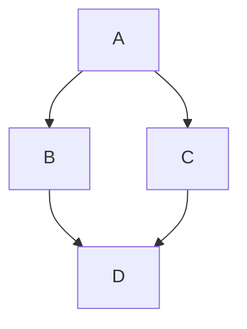

## Date: Week 1 - 08 25 2026

- Topics of discussion
  - Proposal
  - Item2
  - Item3

- Action Items:

* [ ] Lit review
* [ ] Github
* [ ] Experiment diagram
* [ ] Action Item 4
* [ ] Action Item 5

---

## Date: Week 2 - 09 01 2026

- Topics of discussion
  - Proposal
  - Better diagram
  - Item3

- Action Items:

* [ ] Action Item 1
* [ ] Action Item 2
* [ ] Action Item 3
* [ ] Action Item 4
* [ ] Action Item 5

---

## Date: Week 3 - 09 08 2026

- Topics of discussion
  - Showing finalized proposal
  - Get initial pipeline set up
  - Item3

- Action Items:

* [ ] Action Item 1
* [ ] Action Item 2
* [ ] Action Item 3
* [ ] Action Item 4
* [ ] Action Item 5

---

## Date: Week 4 - 09 15 2026

- Topics of discussion
  - Showing initial pipeline
  - Need better results formatting
  - Try to get initial results

- Action Items:

* [ ] Set up organized structure that is understandable for interpreting results
* [ ] Make sure the pipeline is entirely in sync
* [ ] Start fixing the review comments left by professor

---

## Date: Week 5 - 09 22 2026

- Topics of discussion
  - Demonstrate the 3 condition case
  - Switch MAS to use 2 different underlying LLM's to expose different ways of thinking
  - Continue pipeline development

- Action Items:

* [ ] Remove the need for 3 conditioned case
* [ ] Continue integrating pipeline development
* [ ] Work on literature reviews

---

## Date: Week 6 - 09 29 2026

- Topics of discussion
  - NO CLASS

- Action Items:

* [ ] Continue pipeline development
* [ ] Found that we don't need the 3 experimental conditions in the activation collection pipeline

---

## Date: Week 7 - 10 06 2026

- Topics of discussion
  - Finish linear probing
  - Better training of SAE
  - Data cleanup, QC needs to be addressed AFTER preliminary presentations
  - By preliminary presentations, have a full run for a single layer done with causality
  - Goal will be to compare this to an advanced LLM at a later date

- Action Items:

* [x] Complete entirety of experimental pipeline (collection, SAE, probes, causal replay: #51, #99, #118, #128)
* [x] Train a sparse, useful SAE using the 2 different regularization methods (top k and l1) (#99, #118, #127)
* [x] Implement linear probes for both tasks (#51)
* [x] Implement causality pipeline (#128)
* [x] For layer 33 (for inital results), find features to experiment on and run causality experiment (#120, #135)
* [x] Prepare preliminary results presentation (#133, #142)

---

## Date: Week 8 - 10 13 2026

- Topics of discussion
  - NO CLASS

- Action Items:

* [x] Finish training SAE with the 2 training methods (#118, #127)
* [x] Finish feature selection (#120; layer 25 in #134)
* [x] Finish linear probing (#51)
* [x] Finish causality pipeline (#128)
* [x] Run causality pipeline (layers 25 and 33: #134, #135)
* [x] Finish preliminary presentation (#133, #142)

---

## Date: Week 9 - 10 20 2026

- Topics of discussion
  - Preliminary Presentation day
  - Instructor feedback: which layer holds the information, interpretability of the features, algorithm-style
    explanations, the math, SHAP, closer evaluation of causality, Solver bias

- Action Items:

* [x] Layer 25 and 33 causal replay results (#134, #135)
* [x] Feature steering in the causal replay (#140)
* [x] Investigate whether the causal effect is feature-specific: edit-size confound found (#146)
* [x] Adoption feedback pilot (#138)
* [x] Train, validation and test in one activation export; labeled-candidates A2 presentation (#147, #148, #149)

---

## Date: Week 10 - 10 27 2026

- Topics of discussion
  - Instructor Review #6 (#150): causal effects track edit size, not feature identity; no report yet
  - Candidates collection labels, Claude-based labels, synthetic data, and the full mixed collection

- Action Items:

* [x] Final candidate behavior labels (#153) and the Claude behavioral validator (#164, #186)
* [x] Start the LaTeX paper (#169) with the labeling methodology and synthetic pilot (#182)
* [x] Synthetic question generator and related fillers (#163, #184); paired filler ablation (#183)
* [x] Edit-size-matched interventions in the causal replay (#152)
* [x] Prepare and launch the 10-machine mixed collection `mixed_final_001` (#189, #190)
* [ ] Norm-matched causal runs with feature 7025/8023 subsets and >=100 random draws (#146)
* [ ] Retrain probes on Adoption vs Retention with the raw-activation control (#191, #193)
* [ ] Train new SAEs on the mixed collection (#192)

---

## Date: Week 11 - Month Day Year

- Topics of discussion
  - Item1
  - Item2
  - Item3

- Action Items:

* [ ] Action Item 1
* [ ] Action Item 2
* [ ] Action Item 3
* [ ] Action Item 4
* [ ] Action Item 5

---

## Date: Week 12 - Month Day Year

- Topics of discussion
  - Item1
  - Item2
  - Item3

- Action Items:

* [ ] Action Item 1
* [ ] Action Item 2
* [ ] Action Item 3
* [ ] Action Item 4
* [ ] Action Item 5

---

## Date: Week 13 - Month Day Year

- Topics of discussion
  - Item1
  - Item2
  - Item3

- Action Items:

* [ ] Action Item 1
* [ ] Action Item 2
* [ ] Action Item 3
* [ ] Action Item 4
* [ ] Action Item 5

---

## Date: Week 14 - Month Day Year

- Topics of discussion
  - Item1
  - Item2
  - Item3

- Action Items:

* [ ] Action Item 1
* [ ] Action Item 2
* [ ] Action Item 3
* [ ] Action Item 4
* [ ] Action Item 5

---

- **_Add Images and Diagrams Using Excalidraw_**
  - Just draw it and then copy as png paster in the editor
    

- **_Add Equation_**
  - $e^{\pi i} + 1 = 0$

- **_Add Pyhton Code_**

```
import numpy as np
a = np.array()
```

- **_Add Tables as needed._**

| Checkbox Experiments | checked header | crossed header |
| -------------------- | :------------: | :------------: |
| checkbox             |  &check; Row   |  &cross; row   |

- **_Add Tables as needed._**

| checked  | unchecked | crossed  |
| -------- | --------- | -------- |
| &check;  | \_        | &cross;  |
| &#x2611; | &#x2610;  | &#x2612; |

- **_Add Tables as needed._**

| Selection |     |
| --------- | --- |
| &#x2610;  |

| Selection |     |
| --------- | --- |
| &#x2611;  |

- **_Create Links as needed_**
  - [link text](full url minus the en-us locale)

- **_Add Geo Json_**

```geojson
{
  "type": "FeatureCollection",
  "features": [
    {
      "type": "Feature",
      "id": 1,
      "properties": {
        "ID": 0
      },
      "geometry": {
        "type": "Polygon",
        "coordinates": [
          [
            [
              -90,
              35
            ],
            [
              -90,
              30
            ],
            [
              -85,
              30
            ],
            [
              -85,
              35
            ],
            [
              -90,
              35
            ]
          ]
        ]
      }
    }
  ]
}
```

- **_Add flow chart_**


